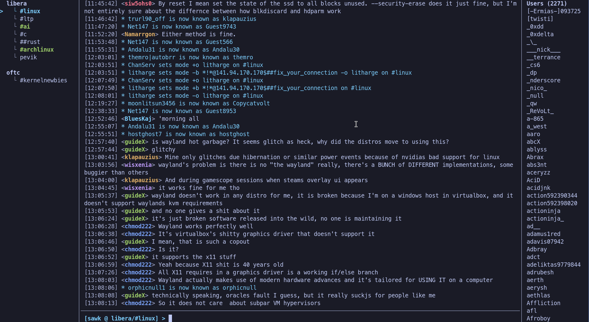

# ronf

A minimal, terminal-based multi-server IRC client written in Rust.

`ronf` connects to multiple IRC networks concurrently and presents a clean
interface designed to match a lightweight, keyboard-driven workflow.



## Installation & Build

Ensure you have a Rust toolchain installed:

```bash
cargo build --release
```

The resulting binary will be located at `target/release/ronf`.

## Configuration

`ronf` looks for its configuration file in the following order:

1. Path passed via command-line argument: `ronf /path/to/config.toml`
2. `~/.config/ronf/config.toml` (or `$XDG_CONFIG_HOME/ronf/config.toml`)
3. `./config.toml` in the current working directory

### Example `config.toml`

```toml
default_nickname = "irc_user"
show_join_part = true
enable_logging = true
history_limit = 100

[servers.libera]
server = "irc.libera.chat"
port = 6697
use_tls = true
channels = [
    "#linux",
    "##rust",
]

[servers.oftc]
server = "irc.oftc.net"
port = 6697
use_tls = true
history_limit = 200
channels = [
    "#kernelnewbies",
]
```

### Chat History & Logging

By default (`enable_logging = true`), `ronf` saves channel and direct message
conversations under `$XDG_DATA_HOME/ronf/logs` (or
`~/.local/share/ronf/logs`, overridable via `log_dir`).

At startup, `ronf` restores past direct message buffers and loads the last
`history_limit` messages (default: `100`, configurable globally or per server;
set `0` to disable) into each buffer. Scrolling up with `PgUp` past the top of
the loaded messages dynamically loads older batches of `history_limit` messages
from disk.

## Keybindings & Commands

### Tree & Buffer Navigation

- `Ctrl+n` / `Alt+Down`: Select next buffer in tree
- `Ctrl+p` / `Alt+Up`: Select previous buffer in tree
- `Alt+a`: Jump directly to next unread buffer (`*`)
- `Alt+1` .. `Alt+9`: Jump directly to buffer 1..9

### Scrolling

- `PgUp` / `PgDn`: Scroll chat history up / down (loads older logged messages
  on demand when reaching the top)
- `Alt+PgUp` / `Alt+PgDn`: Scroll right-hand Users list up / down
- `Esc`: Snap chat scrollback back to latest messages

### Input Editing (Readline)

- `Tab`: Auto-complete nickname or `/command` (press repeatedly to cycle)
- `Up` / `Down`: Navigate sent message history
- `Ctrl+w`: Delete word before cursor
- `Ctrl+u`: Clear input line
- `Ctrl+c`: Cancel current input line
- `Home` (`Ctrl+a`) / `End` (`Ctrl+e`): Move cursor to start / end of line

### Slash Commands

- `/help`: Open the scrollable help modal
- `/join <#channel>`: Join channel on active server
- `/part [reason]`: Leave current channel
- `/msg <target> <text>`: Send private message or message channel
- `/query <nick> [text]`: Open direct message buffer with `<nick>`
- `/nick <newnick>`: Change nickname on active server
- `/me <action>`: Send CTCP action message
- `/topic [text]`: View or set channel topic
- `/whois <nick>`: Query user information via WHOIS
- `/kick <nick> [reason]`: Kick user from active channel
- `/invite <nick> [#chan]`: Invite user to channel
- `/mode [target] <modes>`: Set channel or user modes
- `/op` / `/deop <nick>`: Grant or revoke channel operator (`@`)
- `/voice` / `/devoice <nick>`: Grant or revoke channel voice (`+`)
- `/ban <mask>`: Ban hostmask on active channel (`+b`)
- `/away [reason]`: Set or clear away status
- `/list [filter]`: List channels on active server
- `/motd`: Request server Message of the Day
- `/buffer <target>`: Switch buffer by name or number
- `/raw <irc_line>`: Send raw IRC protocol command
- `/clear`: Clear active buffer message history
- `/close`: Close current channel or direct message buffer
- `/quit [reason]`: Disconnect from all servers and exit

## License

This project is licensed under the GNU General Public License v3.0 or later
(GPL-3.0-or-later). See [LICENSE](LICENSE) for details.
